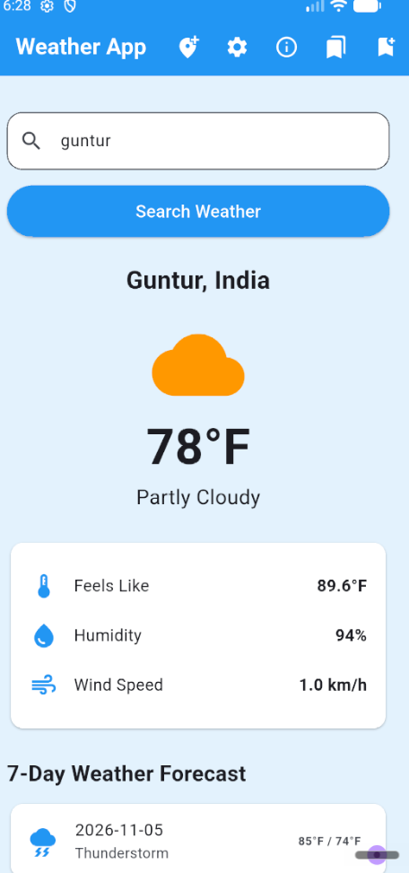
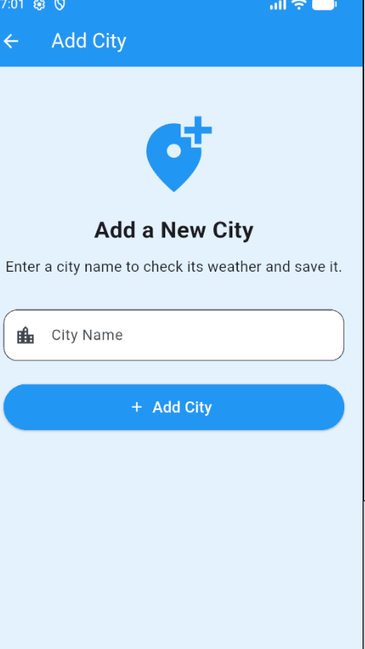
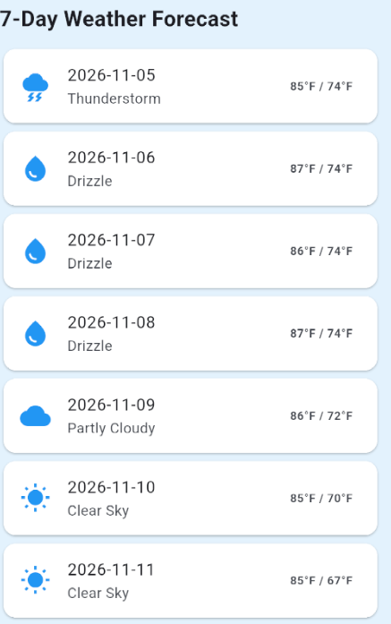

# Weather App

## 1. Project Description
Weather App is a Flutter-based Android application that allows users to search for weather information in different cities. It provides current weather conditions, temperature details, and a 7-day weather forecast using the Open-Meteo API.

## 2. Features
- Search weather by city name.
- View current temperature and weather conditions.
- Check feels-like temperature.
- View humidity and wind speed.
- View a 7-day weather forecast.
- Add and save favourite cities.
- View detailed weather information.
- Change temperature units (Celsius and Fahrenheit).
- Store saved cities using SharedPreferences.

## 3. Technologies Used
- Flutter
- Dart
- Provider (State Management)
- Open-Meteo API
- SharedPreferences

## 4. Screenshots

### Home Screen

### Add City Screen

### Weather Details Screen

## 5. API Used
Open-Meteo Weather API: https://open-meteo.com/

## 6. How to Run the Project
1. Clone this repository.
2. Open the project in VS Code.
3. Run `flutter pub get`.
4. Connect an Android device or start an emulator.
5. Run `flutter run`.

## 7. Team Members
1. RAMANA VYSHNAVI
2. UPPALA SRI LAKSHMI PRASANNA
3. V. SANTHOSH

## 8. Testing
- Widget test executed successfully.
- Release APK generated successfully.

## 9. Team Contributions
- RAMANA VYSHNAVI: Main Flutter application development and implementation.
- UPPALA SRI LAKSHMI PRASANNA: Application testing and feedback.
- V. SANTHOSH: Application testing and feedback.

## 10. Defect Log
Refer to [DEFECT_LOG.md](DEFECT_LOG.md) for testing details and defect status.
