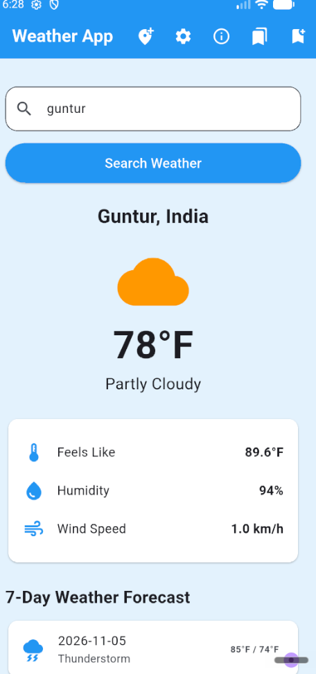
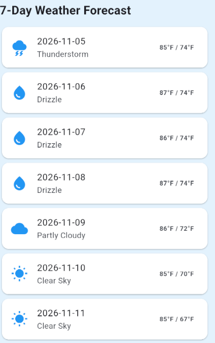
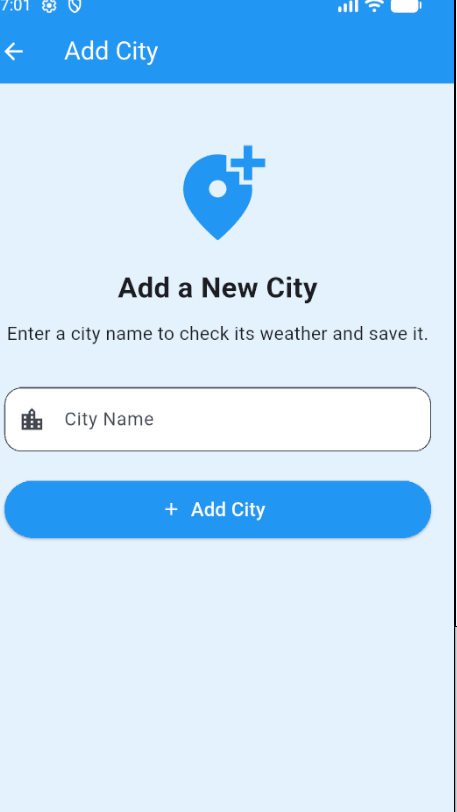

# Weather App

## 1. Project Description

Weather App is a Flutter-based Android application that allows users to search for weather information in different cities. It provides current weather conditions, temperature details, and a 7-day weather forecast using the Open-Meteo API.

## 2. Features

- Search weather by city name.
- View current temperature and weather conditions.
- Check feels-like temperature.
- View humidity and wind speed.
- View a 7-day weather forecast.
- Save favourite cities.
- Add and remove saved cities.
- Change temperature units between Celsius and Fahrenheit.
- View detailed weather information.
- Form validation when adding a city.
- Store saved cities and temperature preferences locally.

## 3. Technologies Used

- Flutter
- Dart
- Provider (State Management)
- Open-Meteo Weather API
- HTTP package
- Shared Preferences
- Visual Studio Code

## 4. Data Source

Weather information is retrieved from the Open-Meteo public API.

- Geocoding API: https://geocoding-api.open-meteo.com/
- Weather API: https://api.open-meteo.com/

The Geocoding API converts city names into geographical coordinates. The Weather API provides current weather conditions and forecast information.

## 5. Team Members

1. RAMANA VYSHNAVI
2. UPPALA SRI LAKSHMI PRASANNA
3. V. SANTHOSH

## 6. Team Contributions

- RAMANA VYSHNAVI: [Add actual work completed]
- UPPALA SRI LAKSHMI PRASANNA: [Add actual work completed]
- V. SANTHOSH: [Add actual work completed]

## 7. Installation and Run Instructions

1. Install Flutter SDK.
2. Install Visual Studio Code.
3. Install Flutter and Dart extensions.
4. Clone or download the project.
5. Open the project folder in VS Code.
6. Open the terminal and run:

```bash
flutter pub get
```

7. Connect an Android device or start an emulator.
8. Run the application:

```bash
flutter run
```

## 8. Testing

Run the Flutter tests using:

```bash
flutter test
```

The available Flutter tests were executed successfully in the development environment.

## 9. Screenshots

### Home Screen



### Weather Details Screen



### Add City Screen



## 10. Release APK

Release APK location:

`build/app/outputs/flutter-apk/app-release.apk`

Build command:

```bash
flutter build apk --release
```

## 11. Defect Log

Refer to the `DEFECT_LOG.md` file for defects identified during application testing, reproduction steps, and their resolution status.

## 12. Future Enhancements

- Improve the user interface.
- Add more weather information.
- Improve error handling and testing.

## 13. Institution

Kallam Harinadh Reddy Institute of Technology (KHIT), Guntur.
